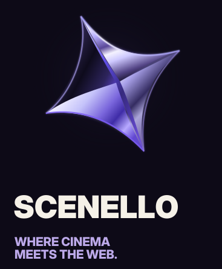
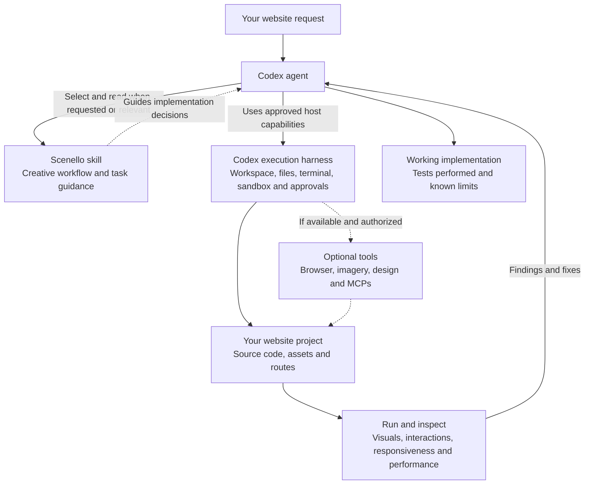

<div align="center">
  
</div>

# Scenello

**Where cinema meets the web.**

Scenello is an open-source **Agent Skill for Codex** that helps turn creative web ideas into original, functional websites. It gives a coding agent a structured approach to art direction, cinematic entrances, scroll-driven transitions, spatial interactions, responsive design, and real-world validation.

Scenello is **not** a website template, a separate AI model, or an autonomous website builder. **Codex writes and runs the code; Scenello guides how it approaches the work.** The result should feel designed for the specific project, not like a generic animation preset applied to every site.

**Version:** `0.5.0-beta.1` · **Status:** Public beta · **License:** MIT for original skill code and documentation

## What Scenello does

Scenello is intended for both new websites and improvements to existing ones. It can guide Codex to:

- **Establish a distinct visual identity.** Choose typography, composition, imagery, materials, and interaction style based on the subject and audience, rather than imposing a fixed design system.
- **Design cinematic entrances.** Give the opening scene a clear subject, reveal, camera or object motion, and meaningful connection to the page's purpose.
- **Connect sections through motion.** Use scroll position to drive transitions, carry an object or visual motif across scenes, and preserve coherent movement when scrolling backward.
- **Build spatial and interactive experiences.** Develop product inspections, animated cards, material changes, and other interactions while keeping navigation and controls usable.
- **Art-direct across screen sizes.** Recompose for mobile and touch rather than simply shrinking the desktop layout; support keyboard access and reduced-motion preferences.
- **Choose practical implementation tools.** Prefer the project's existing stack and the simplest capable technique, from CSS, SVG, and browser animation APIs to 3D when the visual concept truly needs it.
- **Inspect what actually works.** Check rendered states, interaction flows, scroll behavior, and performance evidence when the required tools are available. Report unverified results explicitly.

Scenello adjusts its level of effort to the request:

| Request | Intended approach |
| --- | --- |
| **Small** — one component or focused fix | Preserve the existing design, make the change, and inspect the affected state. |
| **Medium** — a hero or transition | Define the motion, implement it, and validate desktop/mobile and reverse behavior. |
| **Large** — a complete cinematic site | Plan the experience, establish feasible assets and interactions, build functional pages, and validate the critical scenes. |

The goal is **purposeful motion and a usable website**, not animation for its own sake. A cinematic transition should still lead somewhere meaningful.

## How it works with Codex

Scenello runs **inside Codex's existing workflow**. It does not replace the Codex execution harness, create a new agent, or grant extra permissions.



### Who is responsible for what?

| Component | Responsibility |
| --- | --- |
| **You** | Describe the goal, supply project constraints and authorized assets, and approve consequential actions. |
| **Codex agent** | Interpret the request, select the skill, read files, decide what to implement, edit code, invoke tools, and report results. |
| **Scenello** | Supply creative workflows, motion and design methods, project-aware constraints, and verification guidance. |
| **Codex harness** | Provide the actual filesystem, terminal, tools, context handling, sandbox, and approval controls. |
| **Optional tools / MCPs** | Help with specific tasks only if available, appropriate, and authorized. None are required or bundled as a server. |

### What happens during a task?

1. **Discover the skill.** Codex can see Scenello's name and description and, when explicitly invoked or selected by the host, load its `SKILL.md` instructions. For reliable beta testing, invoke **`$scenello` explicitly**.
2. **Understand the project.** Codex checks the existing code, applicable project instructions, assets, framework, and functional requirements before changing anything.
3. **Choose a proportionate workflow.** Scenello helps Codex distinguish a small visual fix from a full cinematic build. Codex reads only the internal guidance needed for that job rather than loading everything.
4. **Define the experience.** For motion-heavy work, Codex identifies the focal subject, entrance, user input, transition, next destination, mobile adaptation, and reduced-motion alternative.
5. **Implement through the harness.** Codex uses the permitted filesystem, terminal, and any relevant optional tools to make changes in your project. Scenello itself does not execute those actions.
6. **Verify and refine.** Codex should inspect the actual browser result where possible, test the relevant interactions, correct observable issues, and explain what it could not verify.

**Harness integration does not mean automatic instrumentation.** For longer tasks, Scenello recommends explicit project-local checkpoints to preserve decisions and progress across context changes. Optional audit helpers exist for scoped, local evidence capture, but they do **not** automatically monitor every Codex action or expose private reasoning. Normal Codex approval and sandbox rules always apply.

## Install and use

### Requirements

- **Codex** with access to a local project/workspace.
- **Python 3.10+** if using the included installation and verification scripts.
- An existing website project (or an empty folder you intend to build in).

No mandatory paid service, MCP server, animation framework, or global configuration change is required.

### 1. Download and extract

Download the Scenello release ZIP from GitHub Releases and extract it **outside** the website project you want to work on. Open a terminal in the extracted Scenello package directory.

For example, if you extracted the ZIP into a folder called `scenello-release` in Downloads, use:

```powershell
Set-Location "$HOME\Downloads\scenello-release"
```

You can also install from a reviewed source checkout. The ZIP integrity check below applies to an **extracted release ZIP** containing `release-checksums.json`, not an ordinary source checkout.

### 2. Verify and preview installation

```powershell
# For an extracted release ZIP (not a source checkout):
py -3 tools/verify_package.py .

# Replace with the path to your actual website project:
$project = Join-Path $HOME "Documents\MyWebsite"

# Preview the exact installation destination; changes nothing:
py -3 tools/install.py $project
```

The project directory must already exist. To create a new empty test project first:

```powershell
New-Item -ItemType Directory -Path $project -Force | Out-Null
```

### 3. Install into the project

```powershell
py -3 tools/install.py $project --apply
```

The installer copies Scenello into:

```text
MyWebsite/
└── .agents/
    └── skills/
        └── scenello/
            ├── SKILL.md
            ├── agents/
            ├── assets/
            ├── references/
            └── scripts/
```

It is a **project-scoped** copy: no global skill installation, extra service, or automatic dependency installation. The installer refuses to overwrite an existing Scenello installation.

On macOS/Linux, use `python3` in place of `py -3` and substitute your project's absolute path.

### 4. Open the website project in Codex

Open **the folder indicated by `$project`** (your target project), not the extracted Scenello package. Refresh or restart Codex if the installed skill is not immediately visible.

Start a new conversation and invoke the skill explicitly:

```text
Use $scenello to create an original landing page for a design studio.
Give the hero a purposeful cinematic entrance and connect it to the
next section through a reversible scroll-driven transition.
Keep navigation functional, adapt the composition for mobile,
respect reduced-motion preferences, and report what you actually verified.
```

You can also use Scenello for a smaller change:

```text
Use $scenello to improve this existing hero section.
Preserve the current brand, content, and navigation.
Create one meaningful entrance animation, then check desktop and mobile.
```

Or for an existing product experience:

```text
Use $scenello to create a scroll-linked handoff from this product hero
to its detail section. Keep the product visually continuous,
make reverse scrolling work, and preserve the existing controls.
```

### 5. Check the result

A successful run should leave you with actual website files and a clear account of the changes. Check that:

- The entrance and transitions are **visible in the browser**, not merely described in code.
- Scroll-driven motion follows real scrolling and reverses correctly.
- Mobile layouts, navigation, interactions, and reduced-motion behavior remain usable.
- Codex distinguishes completed checks from tests it could not perform.

For a quick installation check without spending time on a full site, ask Codex for **one hero or one component**, not a multi-page rebuild.

### Update or uninstall

The installer intentionally will not replace an existing copy. To update, review the new release, preserve local changes, remove or archive the old project-local `.agents/skills/scenello` folder, and rerun the installer. To uninstall, remove only that installed folder after closing sessions that use it. This does not delete your website.

## Limitations

Scenello is a **public beta**. Its purpose is to improve the creative web-building workflow, not to guarantee any particular visual outcome.

- **Activation is not guaranteed.** The skill has been discoverable in a Codex test, but natural/implicit selection has not been independently established. Prefer explicit `$scenello` invocation.
- **It depends on the host.** Codex must have access to the project and the tools required by the requested implementation. Scenello cannot bypass sandbox policies, approval prompts, or missing capabilities.
- **Optional tools are not included.** Image generation, browser automation, GSAP, 3D tooling, and external MCPs may help, but are not required or automatically installed. Their availability, terms, and cost depend on your environment.
- **Visual and performance outcomes vary.** Smooth motion depends on the implementation, assets, browser, and hardware. Scenello cannot promise universal frame-rate, latency, or artistic-quality targets.
- **Verification has limits.** A successful build or passing unit test alone does not prove a cinematic transition looks right. If browser inspection is unavailable, the result must be reported as unverified.
- **Asset rights remain your responsibility.** Use original or properly licensed materials. The public skill does not redistribute private source videos or project archives.
- **Other hosts are not certified.** The package includes an experimental Claude Code installation path, but compatibility has not been independently validated. Other coding agents are untested.
- **It is not a video editor.** Scenello is for functional websites, not promotional reels, soundtracks, or unrelated backend maintenance.
- **Publication approval is separate.** Local checks and a public GitHub release do not imply OpenAI Directory approval or official certification.

**License:** Original Scenello code and written guidance are MIT-licensed. Bundled example fonts have separate OFL-1.1 terms. See `LICENSE`, `THIRD_PARTY_NOTICES.md`, `SECURITY.md`, and `docs/privacy.md` for details.

The Scenello wordmark and ribbon icon are project branding supplied by the project owner; their brand and trademark rights are separate from the MIT code license.
